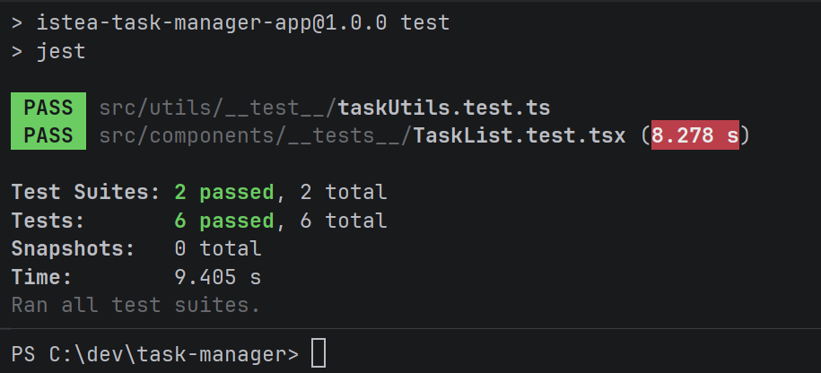
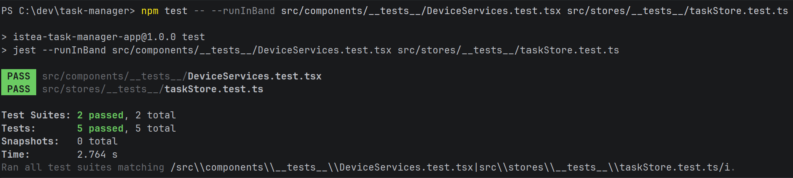

# ISTEA Task Manager
Proyecto parcial de tipo **gestor de tareas** para la materia Aplicaciones Móviles de la Tecnicatura en desarrollo de Software de ISTEA.


# Tecnologías

| Tecnología | Versión | Uso |
| --- | --- | --- |
| Expo | SDK 57 | Plataforma de desarrollo y ejecución multiplataforma |
| React Native | 0.86.3 | Desarrollo de la aplicación móvil |
| React | 19.2.3 | Biblioteca base para la interfaz |
| Expo Router | ~57.0.24 | Navegación y enrutamiento basado en archivos |
| TypeScript | ~6.0.3 | Tipado estático |
| Zustand | ^5.1.0 | Gestión del estado compartido de las tareas |
| React Native Web | ~0.21.0 | Ejecución de la aplicación en la web |
| ESLint | ^9.0.0 | Análisis estático y calidad del código |
| Node.js | 20 o superior | Entorno de ejecución para las herramientas del proyecto |


# Primeros pasos

Se requiere Node.js 20 o superior.

## 1. Instalar las dependencias del proyecto

   ```bash
   npm install
   ```

## 2. Correr la aplicación en emulador Android

   ```bash
   npx expo run:android
   ```
   
> NOTA: 
> Primero se debe tener un emulador con Android corriendo. La compilación puede demorar unos minutos. 

> Si Gradle informa que no encuentra el Android SDK, crear el archivo `android/local.properties` con la ruta local del SDK:
>
> ```properties
> sdk.dir=C:/Users/<usuario>/AppData/Local/Android/Sdk
> ```
>
> Reemplazar `<usuario>` por el usuario de Windows correspondiente y volver a ejecutar `npx expo run:android`.

## 3. Pruebas unitarias
```bash
npm test
```

## 4. Evidencia de pruebas unitarias


# Funcionalidades

## Registro, login y logout
Se implementó una autenticación básica utilizando un componente reutilizable llamado AuthForm, el mismo sirve tanto para registrarse como para iniciar sesión.

La aplicación contiene un botón para hacer logout que remueve la sesión iniciada del storage.

> AuthForm contiene las distintas validaciones, email, password, etc.

## Administración de tareas
Al iniciar sesión, la aplicación ofrece un botón para acceder a la pantalla de **Alta**, donde se pueden crear, eliminar y programar notificaciones para las tareas.

La home de la aplicación muestra las tareas creadas, permite borrarlas y agregarles notificaciones, también contiene una sección especial que reutiliza el componente TasksLists pero solo para mostrar tareas finalizadas.

El estado principal de las tareas se centraliza en `src/stores/taskStore.ts` mediante el Gestor de Estados Zustand. Esta modificación facilita la escalabilidad, evita duplicar el estado entre la pantalla de alta y la home, y permite centralizar las operaciones de carga, creación, actualización, eliminación y cambio de estado. La persistencia continúa a cargo de `taskStorage.ts`, que utiliza `AsyncStorage`.

---

# Segunda parte

## Funcionalidades

Cada tarea nueva puede vincular recursos del dispositivo:

- Una imagen seleccionada desde la galería o tomada con la cámara.
- La ubicación donde se realizará la tarea, mostrando país y provincia.
- El contacto responsable de realizarla, incluyendo nombre, apellido y email.
- Un evento de calendario con una fecha de finalización seleccionada por el usuario.

El componente `DeviceServices` agrupa estos accesos y administra los permisos a través de los services creados en `services/device-apis`, los cuales encapsulan las APIs oficiales de Expo. Si un permiso no fue aceptado, el recurso correspondiente aparece en rojo y se muestra un cartel con la lista de permisos faltantes.

Los permisos se actualizan al volver a la aplicación y se validan de forma independiente para cámara, galería, ubicación, contactos y calendario.

También se incorporaron tests para verificar el cartel de permisos en tres escenarios: todos rechazados, permisos parciales y todos aceptados. En el caso parcial solo aparecen los permisos que faltan. Además, se incluyen pruebas para la integración de Zustand como store principal de tareas.

### Ejecutar los tests de la segunda parte

Para ejecutar únicamente los tests nuevos de permisos y del store de tareas:

```bash
npm test -- --runInBand src/components/__tests__/DeviceServices.test.tsx src/stores/__tests__/taskStore.test.ts
```

**Imagen de los tests:**


## Uso de la IA en este proyecto

Para desarrollar este proyecto se utilizó Codex con el modelo 5.6 Luna, mediante el agente de JetBrains AI Assistant instalado como plugin en el IDE WebStorm. Se utilizaron contextos `low` y `high` según la dificultad y el alcance de cada tarea: un contexto más acotado para cambios simples y uno más amplio para analizar integraciones, permisos y varios archivos relacionados.

### Resumen de los prompts utilizados

1. **Creación de los servicios del dispositivo:** se solicitó agregar debajo del formulario de alta un componente `DeviceServices` con botones para imágenes, ubicación, contactos y calendario. Inicialmente solo el botón de imágenes debía abrir un selector entre cámara y galería.

2. **Organización de las APIs de imágenes:** se definió la estructura `services/device-apis/images`, con los archivos `camera.ts` y `gallery.ts`, y se incorporaron `expo-camera` y `expo-image-picker` para consultar permisos sin abrir todavía las APIs de captura.

3. **Permisos para los demás servicios:** se agregaron directorios y servicios independientes para ubicación, contactos y calendario, utilizando exclusivamente APIs oficiales de Expo.

4. **Estado visual de los permisos:** se definió un mensaje general que enumera los permisos faltantes. Los botones asociados a permisos no otorgados se muestran en rojo.

5. **Actualización de permisos al regresar a la app:** se incorporó la escucha de `AppState` para volver a consultar el estado cuando el usuario regresa desde la configuración del sistema, evitando que los botones permanezcan rojos después de aceptar los permisos.

6. **Cámara y galería:** se implementó la selección de origen, la solicitud de permisos y la apertura de la cámara o del selector de imágenes. De cada resultado se conserva la URI y se muestra una miniatura asociada a la tarea.

7. **Ubicación:** se agregó la solicitud de ubicación actual, la geocodificación inversa y la presentación de país y provincia en la pantalla de alta.

8. **Contactos:** se utilizó el picker oficial de Expo Contacts para seleccionar un contacto y mostrarlo como responsable de la tarea, junto con su email.

9. **Calendario y APIs actuales:** se reemplazaron las APIs obsoletas de Expo Calendar por las nuevas. El calendario permite seleccionar una fecha y crear un evento asociado a la tarea.

10. **Calendario local sin iniciar sesión en Google:** se evitó abrir el formulario de la aplicación de calendario del sistema, porque puede solicitar una cuenta de Google. En su lugar se crea el evento directamente mediante Expo Calendar: primero se reutiliza un calendario local modificable, luego otro calendario modificable ya configurado y, si no existe, se crea uno local llamado `Task Manager`. De esta forma no se inicia sesión en Google para un proyecto básico.

11. **Configuración del Android SDK:** al ejecutar `npx expo run:android` se detectó que Gradle no encontraba el SDK. Se solucionó creando `android/local.properties` con la propiedad `sdk.dir` apuntando a la instalación local del SDK de Android. Esa configuración también quedó documentada en los primeros pasos de este README.

12. **Componentes reutilizables y persistencia:** se creó `TaskInfoCard` para reutilizar el mismo formato en ubicación, responsable y fecha de finalización. La fecha seleccionada se guarda en cada tarea como `completionDate` y se muestra tanto en la pantalla de alta como en la home.

13. **Tests de permisos:** se crearon pruebas de `DeviceServices` que simulan todos los permisos rechazados, permisos parciales y todos los permisos aceptados, verificando cuándo debe aparecer o desaparecer el cartel de error.

14. **Migración del estado de tareas a Zustand:** se solicitó trasladar el estado principal de las tareas a Zustand para facilitar la escalabilidad futura. La solución debía mantener `AsyncStorage` como mecanismo de persistencia, centralizar las operaciones de carga y modificación en `src/stores/taskStore.ts`, adaptar las pantallas `home` y `alta` para compartir el mismo estado, y actualizar `TaskList` para que las modificaciones realizadas desde sus acciones también se reflejaran en el store.
